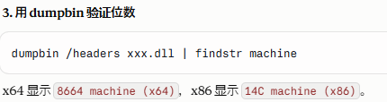

# ftp工具应用
软件：**FileZilla Client 和 FileZilla Server**

FTP Server 会给某个 FTP 用户配置一个或多个允许访问的目录，这通常叫：
Shared folders（共享文件夹）
**还可以设置用户的读写权限**

Server权力：

# 连接模式
控制连接
Client ─────────→ Server
       TCP 21

数据连接
Client ←────────→ Server
       另外的端口

